<p align="center">
  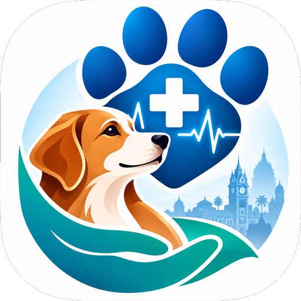
</p>

<h1 align="center">RabiesPulse AI</h1>
<p align="center"><b>Animal-bite help · nearby care · rabies awareness for Chennai</b><br/>
Website + Android app with <b>offline, on-device AI</b> · English · தமிழ் · हिन्दी</p>

## ⬇️ Download

| What | Link | Details |
|---|---|---|
| 📱 **Android app (APK)** | **[Download RabiesPulse-AI-v1.3.apk](https://github.com/cbrethick/RabiesPulse-AI/releases/latest/download/RabiesPulse-AI-v1.3.apk)** | 400 MB · Android 7.0+ · about 3 GB RAM · works **offline** (AI inside) |
| 🌐 **Officer dashboard (website)** | *https://rabiespulse-ai.vercel.app/* | Any browser, phone or desktop · demo login: `rp123@gmail.com` / `rb@123` |
| 📄 **Project report** | [REPORT.md](REPORT.md) | Status, datasets, results |
| 🗂️ **Build history** | [docs/BUILD_HISTORY.md](docs/BUILD_HISTORY.md) | Everything done, start to end |

> **Install the APK:** download it on your phone → open it → allow "Install unknown apps" for your browser or file manager → Install. Then open the app, register, and try **Ask AI** even in airplane mode.

> ⚠️ **Not a medical device.** The app never diagnoses rabies and never gives dose schedules. After any bite: **wash the wound with soap and running water for at least 15 minutes and see a doctor today.**

---

## 📸 Screenshots

### Android app (tested in airplane mode)

| Opening animation | Login (offline) | AI answer (offline) | Nearest care, live GPS (SRM KTR) |
|---|---|---|---|
| 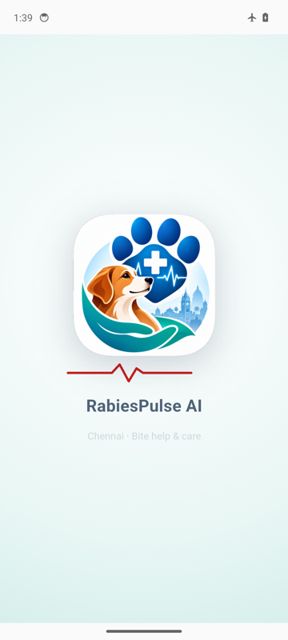 | 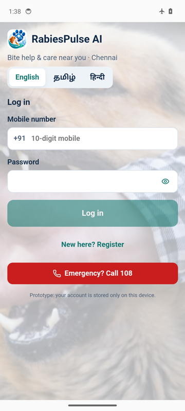 | 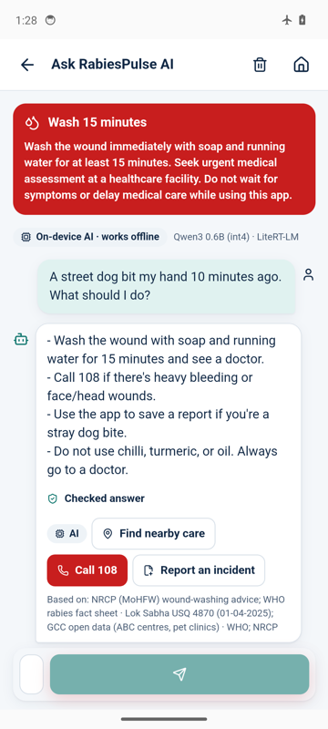 | 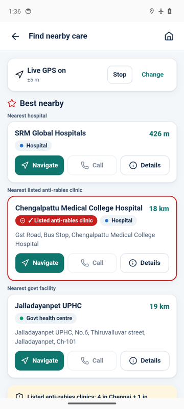 |

### App screens

| Home | Animal bite? | What to do now | Find nearby care |
|---|---|---|---|
| 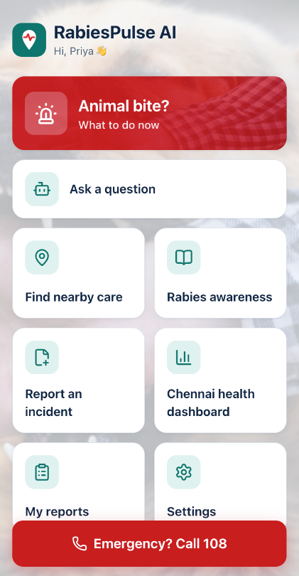 | 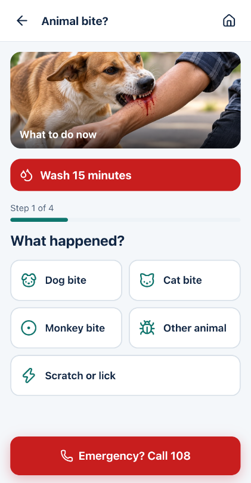 | 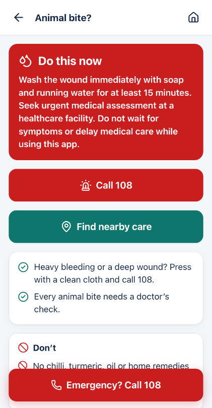 | 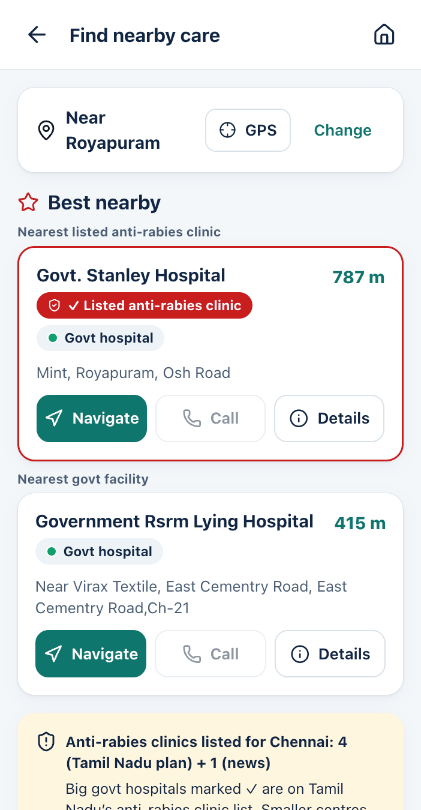 |

| Rabies awareness | Dashboard (phone) | Settings (Tamil, dark) | Live GPS |
|---|---|---|---|
| 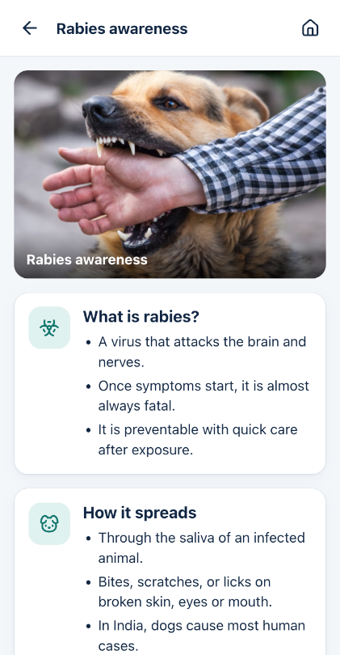 | 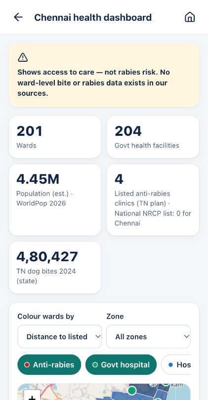 | 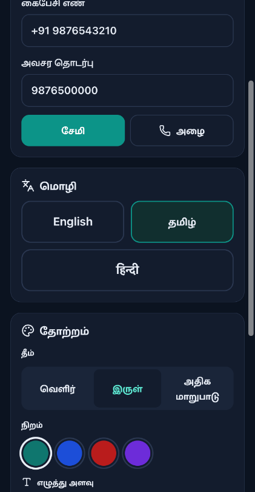 | 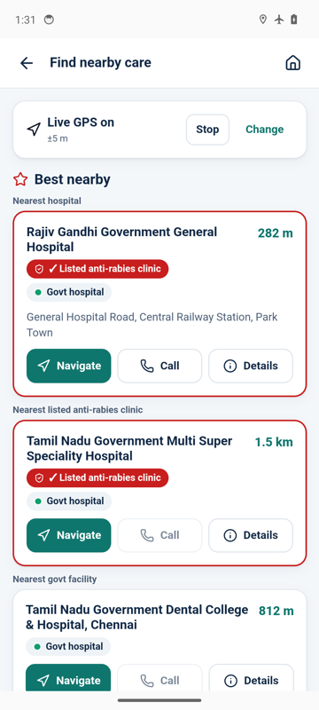 |

### Chennai health dashboard (desktop)

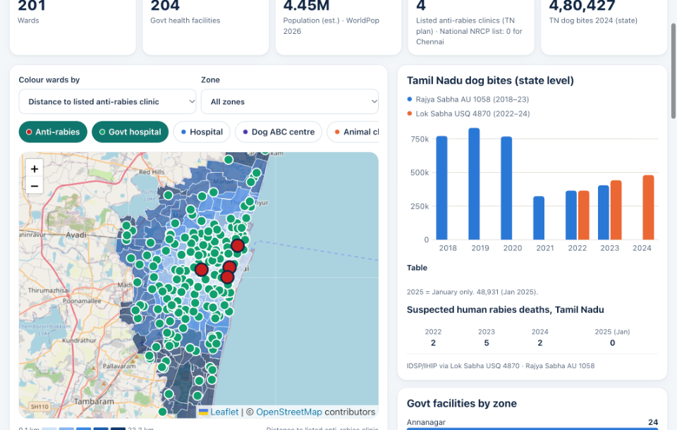

---

## ✨ Features

| Screen | What it does |
|---|---|
| **Login / Register** | Mobile number and password (hashed with PBKDF2; never stored as plain text). Demo verification code (no SMS). Show/hide password. Stays logged in after refresh. Lockout after 5 wrong tries. |
| **Animal bite?** | 4 tap-only questions, then the official *wash 15 minutes* message, Call 108, don'ts, and what to tell the doctor. No diagnosis. |
| **Find nearby care** | Live GPS (asks first, only when you tap) or area search. **Best nearby:** nearest hospital, nearest ✓ listed anti-rabies clinic and nearest government facility. Map/list, filters, **Navigate** (Google Maps), **Call**. |
| **Facility details** | Source and date for every place. Animal clinics and ABC centres are marked "not for human treatment". |
| **Ask AI** | Offline chat. Answers come from a checked answer bank (40 topics in EN/TA/HI, including Tanglish/Hinglish) plus an **on-device AI model** in the APK. No data leaves the phone. |
| **Rabies awareness** | Short cards, myths vs facts, sources, photos. |
| **Report an incident** | Animal, type, date, optional rounded GPS, notes and photo. Saved **only on the phone**. |
| **My reports** | View or delete your saved reports. |
| **Chennai dashboard** | Ward map (distance to anti-rabies clinic, population density, govt facilities per 100k people), zone filter, Tamil Nadu dog-bite trend, access-gap table, data sources. |
| **Settings** | English / தமிழ் / हिन्दी · Light / Dark / High contrast · 4 colours · 3 text sizes · profile and emergency contact · About and data sources. |

---

## 🧠 Offline AI (inside the APK)

| | |
|---|---|
| Runtime | Google **LiteRT-LM** 0.18.0 (Android, Kotlin) |
| Model in the APK | **Qwen3-0.6B int4** (Apache-2.0, 345 MB). Bundled inside the APK, **never downloaded at runtime**. |
| Optional model | **Gemma 3 1B** (better Tamil/Hindi). Accept its licence on Hugging Face, then run `scripts/bundle_model.sh gemma`. |
| Privacy | All AI runs on the phone. Questions and chat history never leave the device. |
| Safety | Answers are grounded in checked facts. The official first-aid text is always shown. No diagnosis or dose schedules. |
| Tested | Android 14 emulator, airplane mode: model ready in **18 s**, first answer in **37 s**. |

---

## 🚀 Run locally

```bash
git clone https://github.com/cbrethick/RabiesPulse-AI.git
cd RabiesPulse-AI
npm install
npm run dev        # open the printed http://localhost:5173 link
npm test           # 22 tests
npm run build      # production build -> dist/
```

You need Node.js 20 or newer. No API keys are required.

---

## 🌐 Deploy the website to Vercel

**Option A — Vercel website (easiest, auto-deploys on every push)**
1. Go to **https://vercel.com** and log in with GitHub.
2. Click **Add New… → Project** and import **cbrethick/RabiesPulse-AI**.
3. Vercel reads `vercel.json` automatically: **Framework:** Vite, **Build command:** `npm run build`, **Output:** `dist`.
4. Leave Environment Variables empty (none are needed).
5. Click **Deploy**. You get a link like `https://rabies-pulse-ai.vercel.app`.
6. Paste that link into the **Website** row of the download table above.

**Option B — Terminal**
```bash
npx vercel login            # opens your browser once
npx vercel deploy --prod    # run inside the project folder
```

---

## 📱 Build the Android APK yourself

You need the Android SDK and JDK 21.

```bash
python3 scripts/download_osm.py          # optional: refresh Greater Chennai map data
python3 scripts/prepare_data.py --offline
scripts/bundle_model.sh qwen             # puts the AI model inside the app
npm run build && npx cap sync android
cd android && ./gradlew assembleRelease
# APK: android/app/build/outputs/apk/release/app-release.apk
```

**Release signing** reads `android/keystore.properties` and `android/keystore/*.jks`. Both are git-ignored. Create your own with `keytool` and keep a backup: you need the same key to publish updates.

**Publish the APK to the download link above:**
1. On GitHub, open **Releases → Draft a new release**.
2. Tag it **v1.3**.
3. Drag in **`RabiesPulse-AI-v1.3.apk`**. Keep this exact file name.
4. Click **Publish**.

---

## 📊 Data used

| Data | Source | Type |
|---|---|---|
| Hospitals, clinics, vets (2,027 places) | OpenStreetMap (Overpass) | OSM |
| UPHC, UCHC, TB, maternity, pet clinics, ABC centres | Greater Chennai Corporation open data | Official |
| ✓ Anti-rabies clinics (5) | Tamil Nadu State Action Plan for Rabies Elimination (Oct 2024) | Official |
| National clinic list (0 for Chennai) | National Rabies Control Programme (26 Mar 2026) | Official |
| Dog bites 2018–2024, suspected deaths | Lok Sabha USQ 4870, Rajya Sabha AU 1058 | Official, state level |
| 200 wards + zones | DataMeet / Transparent Chennai | Boundary |
| Ward population 2026 | WorldPop API (modelled) | Estimate |

All raw files are in `data/raw` and `data/reference`. `scripts/prepare_data.py` builds the app data in `public/data`.

---

## ⚠️ Limitations

- Not medical advice. Vaccine stock and opening hours are not known. Call the hospital first.
- Dog-bite numbers are for the whole state. The dashboard shows **access to care**, not rabies risk.
- Distances are straight-line, not by road.
- Login and reports are stored on one device only. That's fine for a prototype, not for real health records.
- Tamil and Hindi text should be checked by a native speaker.
- The small AI model can make mistakes. Checked answers and the first-aid text are always shown.

---

## 📜 Licences and credits

Map data © OpenStreetMap contributors (ODbL) · Wards: DataMeet / Transparent Chennai (CC BY-SA 2.5 IN) · Population: WorldPop (CC BY 4.0) · Qwen3 (Apache-2.0) · LiteRT-LM (Apache-2.0). See [NOTICE.md](NOTICE.md).

**Made by Rethick CB** — Chennai Rabies Awareness Hackathon, 2026.
