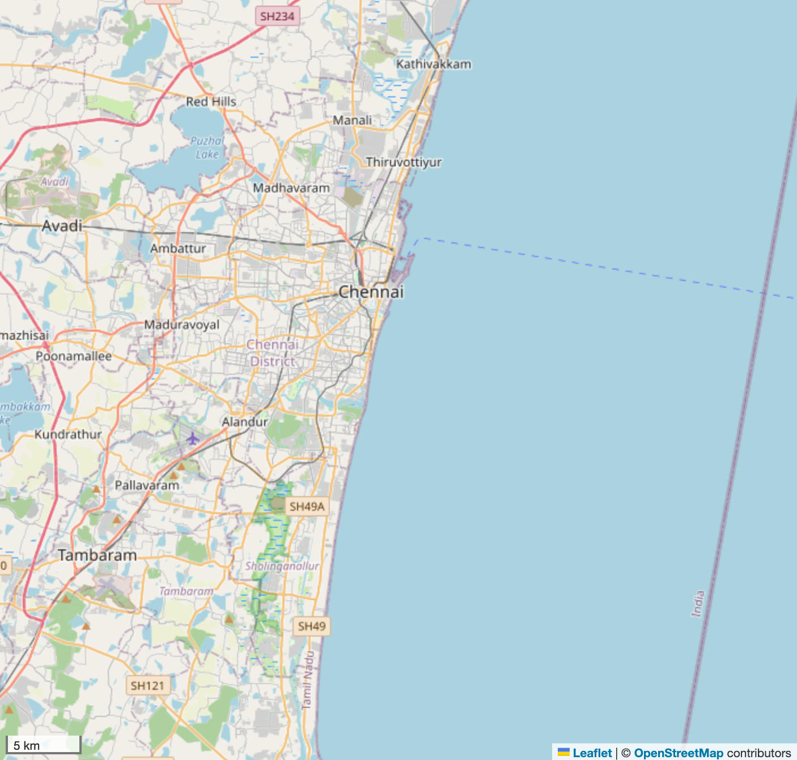

# RabiesPulse AI: build report

*Date: 7 Oct 2026 · Chennai Rabies Awareness Hackathon*

## 1. Status against the prompt

✅ = done and tested · 🟡 = done, partly tested · ⏳ = waiting on you

| # | Requirement | Status | Notes |
|---|---|---|---|
| 1 | Main goal (bite help, care finder, GPS, navigation, awareness, reports, dashboard) | ✅ | All 11 pages work |
| 2 | Local auth (mobile + password, confirm, hashing, session, logout, show/hide, errors, demo code) | ✅ | Tested: register, wrong code, mismatch, weak password, duplicate number, wrong login, unknown number, refresh keeps login, logout, route guard. No plain-text password stored. |
| 3 | GPS and navigation | ✅ | Explanation before asking; asks only on tap; **live GPS** with Stop; denied/timeout/unavailable messages with Retry; area search; tap-on-map; Google Maps directions. **Tested in the APK on an emulator, offline:** live fix ±5 m, list re-sorts when moving (Central → Adyar). At **SRM KTR** the nearest hospital is SRM Global Hospitals (426 m) and the nearest ✓ clinic is Chengalpattu MCH (18 km). |
| 4 | Simple home screen | ✅ | 7 big tiles + Ask AI + sticky "Call 108". Fits one phone screen. |
| 5 | Animal bite assistance | ✅ | 4 tap questions. Exact official wash-15-minutes text. 108 for bleeding. No diagnosis, schedule or "you're safe". |
| 6 | Nearby healthcare finder | ✅ | Map/list, search, distance sort, Navigate, Call, empty state, "Best nearby", clear labels: ✓ listed anti-rabies / govt / hospital / clinic / animal clinic / ABC centre |
| 7 | Rabies awareness | ✅ | 5 short cards, 5 myths vs facts, sources, photo |
| 8 | Incident reporting | ✅ | Saved in IndexedDB on the device only; optional GPS rounded to ~100 m; photo; "not sent to GCC"; "not confirmed cases". Tested save + list in Tamil. |
| 9 | Chennai dashboard | ✅ | Ward map (4 metrics), zone filter, layers, bite chart (2 official sources), deaths, by-zone bars, access-gap table, user reports, data-source table, limitation banner |
| 10 | APIs and data | ✅ | Local data first. WorldPop only at build time (cached). OSM tiles with attribution. No keys. |
| 11 | Tech | ✅ | React + TS + Vite (same stack as your WEB zip), Leaflet, Capacitor, Kotlin |
| 12 | UI (mobile-first, accessible, themes) | ✅ | Tested at 390 px (phone) and 1180 px (desktop): no sideways scroll. EN/TA/HI, light/dark/high contrast, 4 colours, 3 text sizes. |
| 13 | Required pages | ✅ | Login, Register, Home, Bite, Care, Facility, Awareness, Report, My reports, Dashboard, Settings/About/Data, plus Ask AI |
| 14 | Testing | ✅ | `npm test`: 16/16 pass. `tsc` clean. Build clean. Browser walk-through done. |
| 15 | Deliverables | 🟡 | README, NOTICE, `.env.example`, data scripts, **signed APK with on-device AI** (`release/RabiesPulse-AI-v1.0.apk`, 400 MB). **Vercel deploy waiting for your login.** |
| 16 | Offline AI inside the APK | ✅ (emulator) | Bundled **Qwen3-0.6B int4** (Apache-2.0; Gemma is gated, so it's ready as a one-command swap). **Tested on an Android 14 emulator in airplane mode:** clean install → model copied and loaded in 18 s → English answer in 37 s. Tamil from the 0.6B model was garbled, so Tamil/Hindi use the checked answer bank (40 topics). **Not yet tested on a physical phone.** |

## 2. Datasets used

| Dataset | Rows | Type | What I did |
|---|---|---|---|
| OpenStreetMap Overpass export (yours) | 1,084 → 1,046 named | OSM | Classified into govt hospital / hospital / clinic / vet. Dropped 20 unnamed. Removed 18 that duplicate GCC records. |
| OSM Greater Chennai (downloaded once via Overpass, `scripts/download_osm.py`) | 1,936 → 856 new | OSM | Adds Tambaram, Chengalpattu, KTR, Avadi… so SRM KTR has a nearest hospital |
| GCC open data KML (yours, `DTAT/`) | 202 records → 172 places | Official | UPHC 140, UCHC 14, TB 36, maternity 5, pet clinics 4, ABC 3. Merged 30 TB/UPHC records that are the same building. |
| Chennai wards, DataMeet (yours) | 201 | Boundary | Ward/zone joins, centroids, areas, distances |
| WorldPop API (your notes, called once) | 201 wards | Estimate | 2026 population, 100 m: **4,446,697** across the 200 wards + cantonment |
| Lok Sabha USQ 4870 PDF (yours) | TN rows | Official | Dog bites 2022–24 and Jan 2025; suspected deaths 2, 5, 2, 0 |
| Rajya Sabha CSV (yours) | TN row | Official | Bites 2018–23. The file uses `\r` line endings, so it is parsed properly. |
| NRCP clinic list PDF (yours) | 284 | Official | **0 Tamil Nadu/Chennai entries.** Shown honestly. |
| TN State Action Plan PDF (found on the web, NRCP site) | 5 clinics | Official | ✓ badge: RGGGH/MMC, Stanley, Kilpauk, Omandurar + Chengalpattu MCH |
| News, 18 Sep 2025 (web) | 1 | News | Govt Peripheral Hospital Periyar Nagar, labelled "news" |

**Your OSM export** (Overpass Turbo):

## 3. What the app looks like

| Home | Bite: questions | Bite: what to do |
|---|---|---|
|  |  |  |

| Find care (best nearby) | Dashboard (phone) | Settings (Tamil, dark) |
|---|---|---|
|  |  |  |

Dashboard on desktop:

## 4. Key results

- **No Chennai facility is on the national NRCP anti-rabies list.** Four big govt hospitals are on Tamil Nadu's own list, and the app marks only those with ✓.
- **Access gap.** Straight-line distance from each ward's centre to the nearest listed anti-rabies clinic:

  | Ward | Zone | Distance |
  |---|---|---|
  | 200 | Sozhinganallur | 23.3 km |
  | 199 | Sozhinganallur | 22.5 km |
  | 198 | Sozhinganallur | 20.1 km |
  | 197 | Sozhinganallur | 18.9 km |
  | 191 | Perungudi | 18.3 km |

  These southern wards have local govt health centres (about 1–2 km away), but no listed anti-rabies clinic nearby.
- **Tamil Nadu dog bites are rising.** 364,435 (2022), 441,796 (2023) and 480,427 (2024), state level. The two official sources disagree for 2023 (404,488 vs 441,796); both are shown and labelled.
- Facilities on the map: **2,027** (Greater Chennai). 314 of them are government (GCC centres + govt hospitals/PHCs).

## 4b. Android app (APK) — tested on emulator, airplane mode

| Opening animation | Login (offline) | AI answer (offline) | SRM KTR nearest (live GPS) |
|---|---|---|---|
|  |  |  |  |

## 5. Bugs found and fixed while testing

- Leaflet map tiles and points were distorted by a global CSS rule, so the map is now excluded from it.
- Zoom animation could freeze in background/slow WebViews, so programmatic zooms are now instant.
- The Ask page crashed in the latest Chrome because `scrollIntoView` now returns a Promise and an effect returned it.
- Rajya Sabha CSV: old-Mac line endings broke parsing.
- 30 duplicate GCC records (TB centre inside a UPHC) were merged.
- Tamil questions matched "what is rabies" instead of first aid, so retrieval now ignores question words and matches word stems.
- The specialist filter `ent\b` matched the end of "Govern**ment**", hiding all OSM govt hospitals from "Best nearby".
- The RAM check was set for Gemma and would block 3 GB phones from the smaller Qwen model.
- The chat input bar was squashed by the Emergency-bar CSS (seen on the emulator).
- The Overpass API kept timing out (504), so the downloader now caches tiles and splits dense ones.

## 6. Still to do (needs you)

1. **Vercel:** run `! npx vercel login`, then `cd "RabiesPulse AI" && npx vercel deploy --prod`. The build is ready in `dist/`.
2. **Real-phone test:** `adb install release/RabiesPulse-AI-v1.0.apk`, turn on airplane mode, open Ask AI and ask a question. Needs Android 7+ and about 3 GB RAM.
3. **Optional Gemma 3 1B** (better Tamil/Hindi AI): accept the licence on Hugging Face, put `gemma3-1b-it-int4.litertlm` in `DATASET/model/`, then run `scripts/bundle_model.sh gemma` and rebuild.
4. **Optional data:** a TN/GCC anti-rabies centre list, zone bite counts and dog-vaccination counts. These plug into `data/raw/arv_centres_chennai.csv` and the dashboard.
5. Have a native speaker review the Tamil and Hindi text. Confirm you have the rights to the 3 photos; the wound-washing photo shows a red-cross emblem, which is legally protected.
